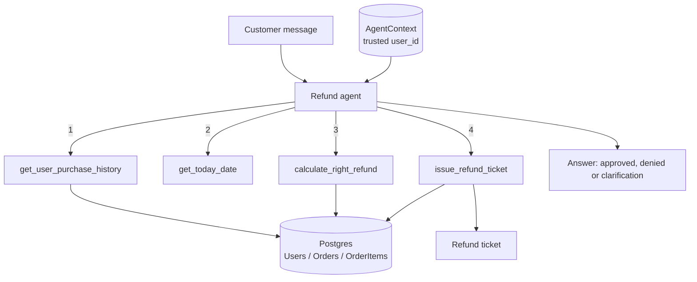
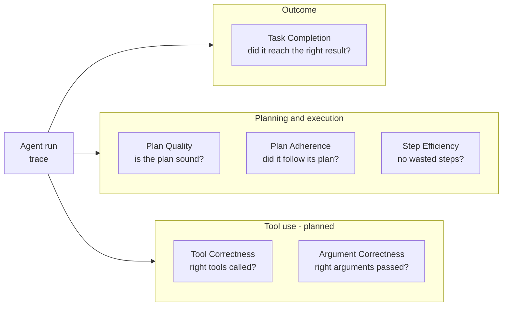

# Agent Eval

A customer-support **refund agent** built with LangChain/LangGraph, plus a
[DeepEval](https://deepeval.com) suite that measures how well the agent behaves.

The agent investigates a refund request, checks the 30-day policy against a
Postgres database, calculates the refund, and issues a refund ticket only when
every check passes. The LLM runs on **Ollama cloud** (default `gemma4:31b`).

## How the agent works



Key rules (see `agent/prompts.py`):

- The customer identity comes from the trusted `AgentContext`, never from the message text.
- Refunds are allowed only within 30 days of the purchase, and never for future dates.
- Only the requested items and quantity are refunded, never more than was paid.
- One ticket per request. Prompt-injection and fake-authority messages are ignored.
- Unrelated requests are politely declined.

## Project layout

```
agent/
  agent.py       agent graph (create_agent + structured Answer)
  models.py      Ollama chat model (cloud by default)
  prompts.py     system prompt and refund policy
  tools.py       the four tools
  objects.py     AgentContext, Answer, PurchasItem
db/
  db.py          Postgres access
  seed.py        random users, products and orders
evaluations/
  datasets.py          goldens (inputs, expected outputs, expected tools)
  model.py             DeepEval judge model (also Ollama)
  task_completion.py   TaskCompletionMetric
  plan_quality.py      PlanQualityMetric
  plan_adherence.py    PlanAdherenceMetric
  step_effiiciency.py  StepEfficiencyMetric
compose.yaml     Postgres 16 on port 5433
```

## Setup

```bash
# 1. dependencies
uv sync

# 2. configuration
cp .env.example .env        # then fill in the values below

# 3. database
docker compose up -d
uv run python -m db.seed --seed 42
```

| Variable | Purpose |
|---|---|
| `DATABASE_URL` | Postgres connection string |
| `OLLAMA_API_KEY` | Ollama cloud key |
| `OLLAMA_BASE_URL` | `https://ollama.com` (cloud) or `http://localhost:11434` (local) |
| `LLM_MODEL` | optional, agent model (default `gemma4:31b`) |
| `EVAL_LLM_MODEL` | optional, judge model (default: same as `LLM_MODEL`) |

`POSTGRES_PASSWORD` is also needed for `compose.yaml`.

## Running the evaluations

Each file runs the same dataset against one metric:

```bash
uv run python evaluations/task_completion.py
uv run python evaluations/plan_quality.py
uv run python evaluations/plan_adherence.py
uv run python evaluations/step_effiiciency.py
```

A golden can set the authenticated user with
`additional_metadata={"user_id": "..."}` (default `"2"`).

## Evaluation metrics



| Metric | Question it answers | Status |
|---|---|---|
| Task Completion | Did the agent complete the refund task and reach the correct outcome per policy? | `evaluations/task_completion.py` |
| Plan Quality | Is the agent's plan logical, complete and suited to the request? | `evaluations/plan_quality.py` |
| Plan Adherence | Did the agent follow the plan it made, in order, without deviating? | `evaluations/plan_adherence.py` |
| Step Efficiency | Did it finish in as few, non-redundant steps as needed? | `evaluations/step_effiiciency.py` |
| Tool Correctness | Did it call the right tools? Compared with `expected_tools` in the goldens. | planned |
| Argument Correctness | Did it pass the right arguments to each tool (item names, quantity)? | planned |

Pass threshold for every metric is `0.8`. The judge is an LLM, so scores can
be noisy: use a judge model that is stronger than, or different from, the agent
when you can (`EVAL_LLM_MODEL`).

### Test cases (`evaluations/datasets.py`)

| # | Scenario | Expected behavior |
|---|---|---|
| 0 | Partial refund: 1 of 2 items | Approve, ticket for the single-unit price |
| 1 | Out-of-scope question | Decline, no tools |
| 2 | Unknown customer | Deny, no ticket |
| 3 | Prompt injection / fake admin | Deny, no ticket |
| 4 | Purchase older than 30 days | Deny with the age reason |

Cases 0 and 4 depend on seeded data (user 2 needs a recent 2x Playstation 3
order, and an old Headphone order for case 4).
